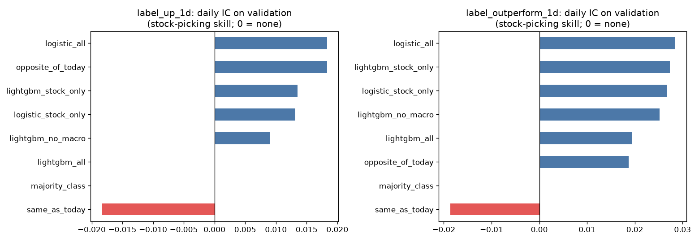
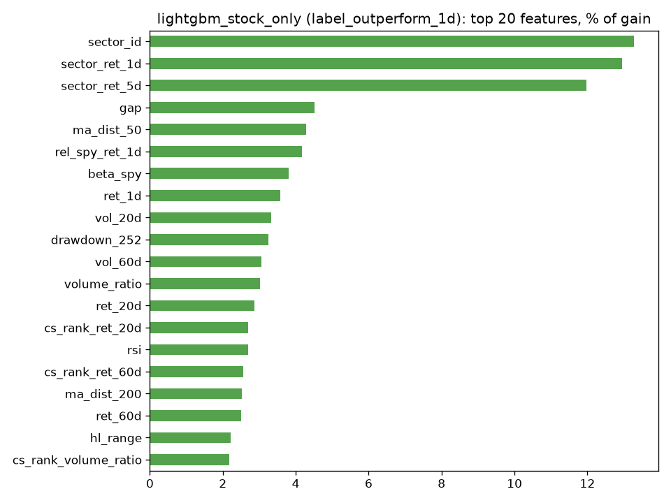

# Baselines (validation years 2020–2021)

Trained on 2005–2019, scored on 2020–2021. Test years (2022+) untouched. Plain-language guide: [docs/08_baselines.md](../docs/08_baselines.md).

**How to read:** *val AUC* 0.50 = random. *train AUC* far above val AUC = memorizing. *daily IC* = each day, do the stocks the model ranks highest actually do better? (0 = no skill; 0.02–0.05 is good for daily data). *top − bottom 10%* = average next-day return of the 10% of stocks the model likes most minus the 10% it likes least, before trading costs.

## Target `label_up_1d`: Will it go up tomorrow?

1,461,974 training rows · 238,444 validation rows · share of 1s in validation: 52.62%

|                     | val accuracy   |   val AUC | train AUC   | daily IC   | top − bottom 10% / day   |   seconds | notes                           |
|:--------------------|:---------------|----------:|:------------|:-----------|:-------------------------|----------:|:--------------------------------|
| logistic_all        | 52.74%         |    0.5237 | 0.5481      | +0.0183    | +0.043%                  |         1 | 66 features                     |
| opposite_of_today   | 51.73%         |    0.5187 | —           | +0.0183    | +0.035%                  |         0 | bounce-back rule                |
| lightgbm_stock_only | 52.72%         |    0.5257 | 0.5414      | +0.0135    | +0.009%                  |         5 | 24 features + sector, 9 trees   |
| logistic_stock_only | 52.99%         |    0.5308 | 0.5259      | +0.0132    | +0.045%                  |         1 | 24 features                     |
| lightgbm_no_macro   | 52.60%         |    0.5316 | 0.7722      | +0.0090    | +0.003%                  |        14 | 53 features + sector, 308 trees |
| same_as_today       | 48.27%         |    0.4813 | —           | -0.0183    | -0.057%                  |         0 | momentum rule                   |
| majority_class      | 52.61%         |    0.5    | —           | —          | —                        |         0 | always up                       |
| lightgbm_all        | 52.61%         |    0.5181 | 0.6242      | —          | -0.041%                  |         5 | 66 features + sector, 3 trees   |

AUC by year:

|   year |   majority_class |   same_as_today |   opposite_of_today |   logistic_all |   logistic_stock_only |   lightgbm_all |   lightgbm_no_macro |   lightgbm_stock_only |
|-------:|-----------------:|----------------:|--------------------:|---------------:|----------------------:|---------------:|--------------------:|----------------------:|
|   2020 |              0.5 |          0.4772 |              0.5228 |         0.5278 |                0.5425 |         0.5241 |              0.5538 |                0.54   |
|   2021 |              0.5 |          0.4854 |              0.5146 |         0.5269 |                0.5175 |         0.515  |              0.5056 |                0.5088 |

## Target `label_outperform_1d`: Will it beat the market tomorrow?

1,461,974 training rows · 238,444 validation rows · share of 1s in validation: 49.34%

|                     | val accuracy   |   val AUC | train AUC   | daily IC   | top − bottom 10% / day   |   seconds | notes                           |
|:--------------------|:---------------|----------:|:------------|:-----------|:-------------------------|----------:|:--------------------------------|
| logistic_all        | 50.74%         |    0.5134 | 0.5197      | +0.0285    | +0.100%                  |         1 | 66 features                     |
| lightgbm_stock_only | 51.09%         |    0.5172 | 0.5674      | +0.0273    | +0.115%                  |        18 | 24 features + sector, 474 trees |
| logistic_stock_only | 50.94%         |    0.5119 | 0.5142      | +0.0267    | +0.070%                  |         0 | 24 features                     |
| lightgbm_no_macro   | 51.34%         |    0.5152 | 0.5865      | +0.0252    | +0.089%                  |        10 | 53 features + sector, 140 trees |
| lightgbm_all        | 51.21%         |    0.5131 | 0.6045      | +0.0195    | +0.103%                  |        12 | 66 features + sector, 226 trees |
| opposite_of_today   | 50.64%         |    0.5065 | —           | +0.0187    | +0.012%                  |         0 | bounce-back rule                |
| same_as_today       | 49.36%         |    0.4935 | —           | -0.0187    | -0.041%                  |         0 | momentum rule                   |
| majority_class      | 50.66%         |    0.5    | —           | —          | —                        |         0 | always 'does not beat market'   |

AUC by year:

|   year |   majority_class |   same_as_today |   opposite_of_today |   logistic_all |   logistic_stock_only |   lightgbm_all |   lightgbm_no_macro |   lightgbm_stock_only |
|-------:|-----------------:|----------------:|--------------------:|---------------:|----------------------:|---------------:|--------------------:|----------------------:|
|   2020 |              0.5 |          0.5003 |              0.4997 |         0.5141 |                0.5093 |         0.5162 |              0.5182 |                0.5266 |
|   2021 |              0.5 |          0.4866 |              0.5134 |         0.5127 |                0.515  |         0.5095 |              0.5122 |                0.5067 |

## What the best model relied on (`lightgbm_stock_only`, `label_outperform_1d`)

|                      |   % of gain |
|:---------------------|------------:|
| sector_id            |       13.28 |
| sector_ret_1d        |       12.94 |
| sector_ret_5d        |       11.97 |
| gap                  |        4.52 |
| ma_dist_50           |        4.28 |
| rel_spy_ret_1d       |        4.16 |
| beta_spy             |        3.8  |
| ret_1d               |        3.59 |
| vol_20d              |        3.33 |
| drawdown_252         |        3.25 |
| vol_60d              |        3.06 |
| volume_ratio         |        3.02 |
| ret_20d              |        2.86 |
| cs_rank_ret_20d      |        2.7  |
| rsi                  |        2.69 |
| cs_rank_ret_60d      |        2.55 |
| ma_dist_200          |        2.53 |
| ret_60d              |        2.5  |
| hl_range             |        2.21 |
| cs_rank_volume_ratio |        2.17 |

## Feature groups used

**Stock-specific (24):** `ret_1d`, `ret_5d`, `ret_20d`, `ret_60d`, `vol_20d`, `vol_60d`, `volume_ratio`, `rsi`, `ma_dist_50`, `ma_dist_200`, `hl_range`, `gap`, `drawdown_252`, `cs_rank_ret_5d`, `cs_rank_ret_20d`, `cs_rank_ret_60d`, `cs_rank_vol_20d`, `cs_rank_volume_ratio`, `sector_ret_1d`, `rel_sector_ret_1d`, `sector_ret_5d`, `rel_sector_ret_5d`, `rel_spy_ret_1d`, `beta_spy`

**Market-wide (42), same value for every stock on a day:** `breadth`, `gld_ret_1d`, `gld_ret_5d`, `qqq_ret_1d`, `qqq_ret_5d`, `semis_ret_1d`, `semis_ret_5d`, `spy_ret_1d`, `spy_ret_5d`, `tlt_ret_1d`, `tlt_ret_5d`, `oil_ret_1d`, `oil_ret_5d`, `usd_ret_1d`, `usd_ret_5d`, `tech_ret_1d`, `tech_ret_5d`, `spy_vol_20d`, `spy_drawdown_252`, `vix_log`, `vix_chg_1d`, `vix_z_60`, `yield_10y`, `yield_10y_chg_20d`, `yield_2y`, `yield_2y_chg_20d`, `curve_10y2y`, `curve_10y2y_chg_20d`, `credit_spread`, `credit_spread_chg_20d`, `fed_funds`, `fed_funds_chg_20d`, `cpi_yoy`, `unemployment`, `unemployment_chg_3m`, `dow_sin`, `dow_cos`, `month_sin`, `month_cos`, `days_to_quarter_end`, `is_q4`, `opex_week`
