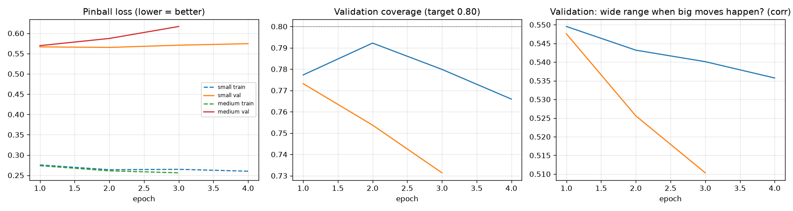
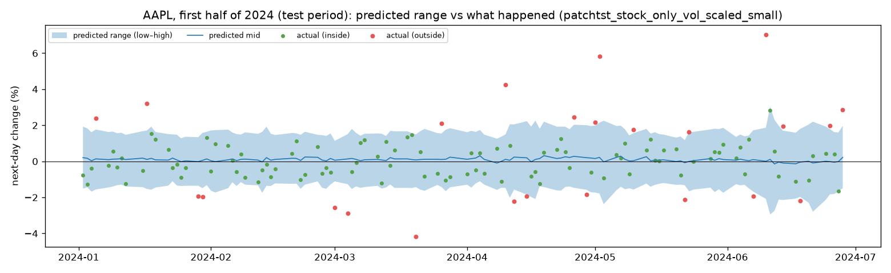

# PatchTST range forecast: results

Task: forecast tomorrow's change as a range (low = 10th, mid = 50th, high = 90th percentile), in %. Main run: `stock_only_vol_scaled` (inputs_target). Runs compared: `stock_only_vol_scaled`, `all_vol_scaled`, `all_raw`. 128-day windows. Plain-language guide: [docs/09_training.md](../docs/09_training.md).

## Training of `stock_only_vol_scaled` (validation = 2020–2021)

Best epoch per size:

| size   |      params |   epoch |   train_loss |   val_loss |   coverage |   width_vs_move_corr |   mid_daily_ic |
|:-------|------------:|--------:|-------------:|-----------:|-----------:|---------------------:|---------------:|
| small  | 116163.0000 |  2.0000 |       0.2637 |     0.5652 |     0.7922 |               0.5432 |         0.0238 |
| medium | 628355.0000 |  1.0000 |       0.2737 |     0.5696 |     0.7732 |               0.5476 |         0.0151 |

**Chosen size: `small`** (lowest validation loss).

## Validation 2020–2021

| model                                |   pinball loss | coverage   | below low / above high   | avg width   |   width~move corr | mid corr   | mid daily IC   | mid sign acc   |
|:-------------------------------------|---------------:|:-----------|:-------------------------|:------------|------------------:|:-----------|:---------------|:---------------|
| zero_band                            |         0.6211 | 71.3%      | 13.8% / 14.9%            | 3.95%       |            -0     | —          | —              | 52.6%          |
| vol_band                             |         0.581  | 79.7%      | 9.7% / 10.6%             | 5.74%       |             0.455 | —          | —              | 47.4%          |
| lightgbm_q                           |         0.5733 | 75.9%      | 12.1% / 12.0%            | 4.69%       |             0.533 | -0.0603    | —              | 52.6%          |
| lightgbm_q_stock_only                |         0.5649 | 76.9%      | 10.8% / 12.3%            | 5.01%       |             0.55  | +0.0616    | +0.0172        | 52.7%          |
| patchtst_stock_only_vol_scaled_small |         0.5652 | 79.2%      | 11.5% / 9.2%             | 5.29%       |             0.543 | +0.0500    | +0.0238        | 52.1%          |
| patchtst_all_vol_scaled_small        |         0.5883 | 73.3%      | 13.8% / 12.9%            | 4.81%       |             0.532 | +0.0229    | +0.0067        | 51.1%          |
| patchtst_all_raw_small               |         0.6017 | 66.3%      | 18.2% / 15.5%            | 3.96%       |             0.456 | +0.0166    | +0.0123        | 51.7%          |

## Test 2022 → today (scored once, never used for any decision)

| model                                |   pinball loss | coverage   | below low / above high   | avg width   |   width~move corr | mid corr   | mid daily IC   | mid sign acc   |
|:-------------------------------------|---------------:|:-----------|:-------------------------|:------------|------------------:|:-----------|:---------------|:---------------|
| zero_band                            |         0.5018 | 76.3%      | 11.8% / 11.9%            | 3.95%       |             0     | —          | —              | 51.4%          |
| vol_band                             |         0.4919 | 81.0%      | 9.4% / 9.6%              | 4.98%       |             0.298 | —          | —              | 48.6%          |
| lightgbm_q                           |         0.4825 | 78.9%      | 9.5% / 11.6%             | 4.39%       |             0.362 | +0.0041    | —              | 51.5%          |
| lightgbm_q_stock_only                |         0.4813 | 79.2%      | 10.6% / 10.2%            | 4.47%       |             0.376 | +0.0190    | +0.0076        | 51.4%          |
| patchtst_stock_only_vol_scaled_small |         0.4859 | 80.7%      | 11.2% / 8.1%             | 4.72%       |             0.368 | +0.0062    | +0.0057        | 51.2%          |
| patchtst_all_vol_scaled_small        |         0.4969 | 77.6%      | 12.0% / 10.5%            | 4.54%       |             0.361 | +0.0184    | +0.0049        | 51.4%          |
| patchtst_all_raw_small               |         0.4925 | 76.7%      | 12.4% / 10.9%            | 4.39%       |             0.359 | +0.0130    | +0.0006        | 51.0%          |

**How to read:** *coverage* should be ~80% with ~10% below and ~10% above. *avg width* smaller is better only if coverage holds. *width~move corr*: does the range widen when big moves happen? *mid* columns: does the middle guess say anything about direction (0 = nothing)?
